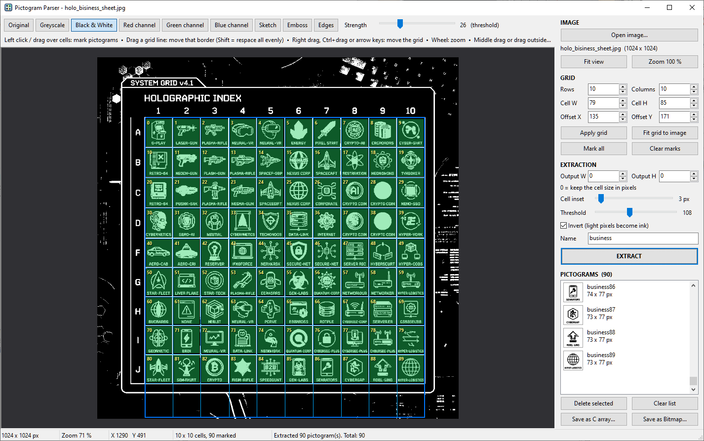

# Pictogram Parser

A Windows desktop app (C++17, Win32 + GDI+) that cuts a sheet of pictograms into small images, black and
white or in full colour, which you can save as C arrays or as `.bmp` files.

## Download

Grab `PictogramParser-<version>-win64.zip` from the [Releases](https://github.com/ErickDoppler/Pictogram-Parser/releases) page, unzip it and
run `PictogramParser.exe`. Windows 10 / 11, 64-bit. It is a single file and needs no installation.

## Build

Run `build.bat`. It uses the toolchain in `C:\workenv` (w64devkit GCC, CMake, Ninja).
The result is `build\PictogramParser.exe`. It is statically linked, so it needs no extra DLLs.

## Workflow

1. **Open image...** loads a PNG/BMP/JPG/GIF/TIFF/ICO sheet. Transparent pixels become white.
2. **Preprocessing** (buttons above the preview): Original, Greyscale, Black & White, Red / Green / Blue
   channel, Sketch, Emboss, Edges. The **Strength** slider controls the setting that fits the current effect:
   saturation, contrast, threshold, brightness, pencil width, depth or edge sensitivity.
   Extraction always uses the preprocessed image.
3. **Grid**: set Rows / Columns / Cell size / Offset, then **Apply grid**. **Fit grid to image** splits the
   whole image evenly.
   - Drag a grid line to move that border along the whole row or column.
     Hold **Shift** while dragging to respace every line evenly, so all cells get the same size.
   - Right-drag, Ctrl+drag or the arrow keys (Shift = 10 px) move the whole grid.
   - Click a cell, or drag across cells, to mark or unmark pictograms. The yellow numbers show the extraction order.
   - Mouse wheel zooms. Middle-drag, or a drag outside the grid, pans. `F` fits the view.
4. **Extraction**: Output W/H sets the size of the pictogram (0 = keep the cell size).
   **Cell inset** cuts that many pixels off every side of each cell before extracting, which removes a grid
   drawn into the sheet: snap the app's grid onto the drawn lines, then raise the inset until the lines are
   outside the green area. While you move the slider, the margins that will be cut off are shaded red on the
   unmarked cells, and the green fill of marked cells always shows exactly the area that will be extracted.
   The output mode decides what a cell becomes:
   - **Black and White**: pixels darker than **Threshold** become ink (1-bit).
   - **Inverted Black and White**: the same, but light pixels become ink. Use it for light pictograms on a dark
     background.
   - **Full Color**: the cell exactly as the preview shows it, with the current effect applied. Threshold is
     ignored.

   **Name** is the prefix: pictograms are called `<name><number>`, numbered from 0. **EXTRACT** (Ctrl+E) adds
   every marked cell to the list.
5. **Save as C array...** writes one header file. **Save as Bitmap...** writes one `.bmp` per pictogram into the
   folder you choose: 1-bit for black-and-white pictograms, 24-bit for colour ones. One list can mix both.

## C array format

Each pictogram has a format:

- **MONO1** (black and white): a `uint8_t` array, 1 bit per pixel, row by row, MSB = leftmost pixel. Every row is
  padded to whole bytes, so a row takes `(width + 7) / 8` bytes. A bit of 1 is a black (ink) pixel. Each row
  comes with an ASCII preview.
- **RGB565** (full colour): a `uint16_t` array, one pixel per value, row by row. Bits 15-11 are red, 10-5
  green, 4-0 blue.

Every array has `_WIDTH`, `_HEIGHT` and `_FORMAT` defines. A lookup table `<file>_table[]` lists all
pictograms with their name, size, format and a pointer to the data.

## License

MIT, see [LICENSE](LICENSE).
